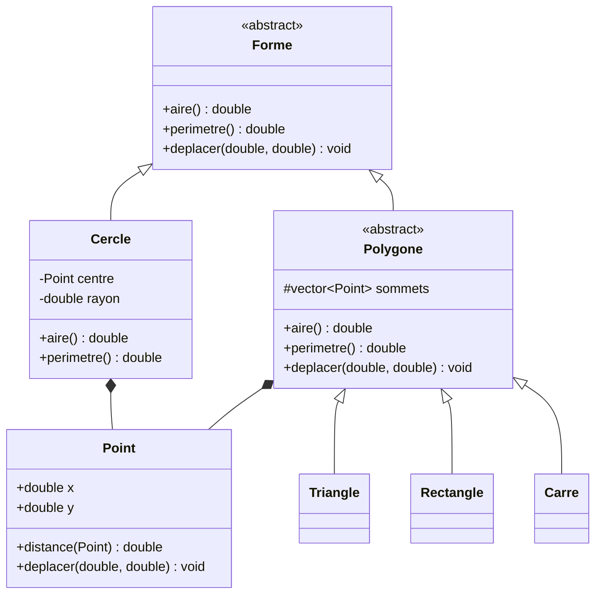
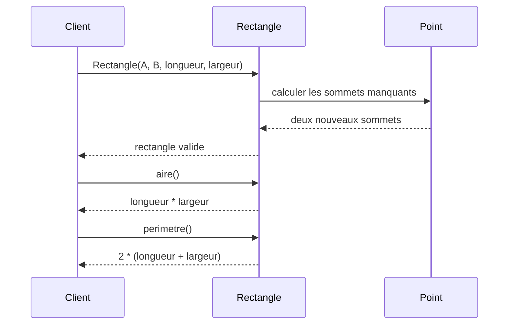

# Projet POO - Objets géométriques

Application de conception et de manipulation d'objets géométriques simples,
réalisée dans le cadre du Prosit « Un problème d'héritage ».

Le projet se concentre volontairement sur la conception et l'implémentation
des classes métier en C++. L'interface graphique n'est pas incluse dans cette
version.

## Objectifs

L'application doit permettre de :

- représenter des points et des formes géométriques ;
- créer des cercles, triangles, carrés et rectangles ;
- calculer l'aire et le périmètre de chaque forme ;
- déplacer les formes et accéder à leurs sommets ou coordonnées ;
- mutualiser le comportement commun grâce à une hiérarchie de classes ;
- conserver une conception extensible pour l'ajout de nouvelles formes.

## Choix de conception

Toutes les formes sont manipulées à travers la classe abstraite `Forme`.
Chaque forme concrète implémente ses propres calculs d'aire et de périmètre :
le calcul générique d'un polygone auto-sécant n'est donc pas imposé à la
classe `Polygone`.

Un carré et un rectangle sont deux spécialisations distinctes de `Polygone`.
Ce choix évite de représenter artificiellement la contrainte `longueur =
largeur` par un attribut inutile ou par une relation d'héritage qui ne
respecterait pas correctement le principe de substitution.

```text
Forme (abstraite)
├── Cercle
└── Polygone (abstraite)
    ├── Triangle
    ├── Rectangle
    └── Carre
```

### Responsabilités principales

| Classe | Responsabilité |
| --- | --- |
| `Point` | Stocker une position 2D et effectuer les opérations de base sur celle-ci. |
| `Forme` | Définir l'interface commune : aire, périmètre et déplacement. |
| `Cercle` | Représenter un centre et un rayon, puis calculer son aire et son périmètre. |
| `Polygone` | Factoriser le stockage ordonné des sommets et les opérations communes aux polygones. |
| `Triangle` | Représenter trois sommets et calculer son aire et son périmètre. |
| `Rectangle` | Construire un rectangle à partir de deux sommets et de ses dimensions. |
| `Carre` | Construire un carré à partir de deux sommets et de la longueur de son côté. |

Les classes doivent respecter les invariants suivants :

- le rayon d'un cercle est strictement positif ;
- la longueur et la largeur d'un rectangle sont strictement positives ;
- le côté d'un carré est strictement positif ;
- un triangle possède trois sommets non alignés ;
- les sommets d'un polygone sont stockés dans l'ordre de parcours ;
- les opérations polymorphes utilisent un destructeur virtuel.

Les entrées invalides doivent être signalées explicitement, par exemple au
moyen de `std::invalid_argument`. Elles ne doivent pas produire une forme
partiellement construite ou un résultat silencieusement incorrect.

## Organisation du projet

La structure cible est la suivante :

```text
.
├── CMakeLists.txt
├── include/
│   └── geometrie/
│       ├── Point.hpp
│       ├── Forme.hpp
│       ├── Cercle.hpp
│       ├── main.cpp
│       ├── Polygone.hpp
│       ├── Triangle.hpp
│       ├── Rectangle.hpp
│       └── Carre.hpp
└── docs/
    ├── diagramme-classes.md
    └── diagramme-sequence.md
```

Les fichiers d'en-tête contiennent les interfaces publiques et les fichiers
`.cpp` leur implémentation. Le code de test ne doit pas dépendre d'une
interface graphique.

## Interface minimale recommandée

Les noms peuvent être adaptés aux conventions retenues par le groupe, mais
les responsabilités suivantes doivent rester présentes :

```cpp
class Forme {
public:
    virtual ~Forme() = default;

    virtual double aire() const = 0;
    virtual double perimetre() const = 0;
    virtual void deplacer(double dx, double dy) = 0;
};
```

`Cercle` possède un `Point centre` et un `double rayon`.
`Polygone` possède une collection ordonnée de `Point`.
`Triangle`, `Rectangle` et `Carre` valident leur géométrie à la construction
et exposent leurs sommets via une interface en lecture seule.

Les calculs doivent utiliser `double` et une constante `PI` centralisée.
Les tests de résultats flottants doivent utiliser une tolérance plutôt qu'une
comparaison directe avec `==`.

## Formules attendues

- Cercle :
  - aire : `π × rayon²`
  - périmètre : `2 × π × rayon`
- Triangle :
  - périmètre : somme des trois longueurs de côtés ;
  - aire : formule de Héron ou produit vectoriel.
- Rectangle :
  - aire : `longueur × largeur` ;
  - périmètre : `2 × (longueur + largeur)`.
- Carré :
  - aire : `côté²` ;
  - périmètre : `4 × côté`.

Pour un rectangle ou un carré incliné, le vecteur défini par les deux sommets
fournis sert de direction. Le vecteur perpendiculaire de même norme permet de
calculer les deux sommets restants sans supposer un alignement avec les axes.

## Diagramme de classes

Le diagramme ci-dessous constitue la base commune à implémenter et à faire
évoluer dans `docs/diagramme-classes.md`.



## Exemple de scénario

La création d'un rectangle et l'affichage de ses propriétés suivent le
scénario suivant :



## Compilation et tests

La compilation se fera avec CMake afin que tous les collaborateurs utilisent
la même procédure :

```powershell
cmake -S . -B build
cmake --build build
ctest --test-dir build --output-on-failure
```

Les tests doivent couvrir au minimum :

- les valeurs d'aire et de périmètre des quatre formes ;
- les formes orientées, notamment les rectangles et carrés inclinés ;
- le déplacement d'une forme ;
- le rejet des dimensions nulles ou négatives ;
- le rejet d'un triangle dégénéré ;
- l'utilisation d'une forme concrète à travers une référence ou un pointeur
  vers `Forme`.

## Répartition conseillée du travail

1. Valider le diagramme de classes et les conventions de nommage.
2. Implémenter `Point`, puis `Forme`.
3. Implémenter `Cercle` et les calculs de distance.
4. Implémenter `Polygone`, `Triangle`, `Rectangle` et `Carre`.
5. Ajouter les tests unitaires au fur et à mesure.
6. Finaliser les diagrammes et vérifier la compilation complète.

Toute modification de l'architecture doit être discutée dans une pull
request et accompagnée des tests associés.

## Hors périmètre

- interface graphique ;
- sauvegarde ou chargement de fichiers ;
- polygones auto-sécants génériques ;
- gestion d'une base de données ;
- fonctionnalités non nécessaires aux calculs géométriques.